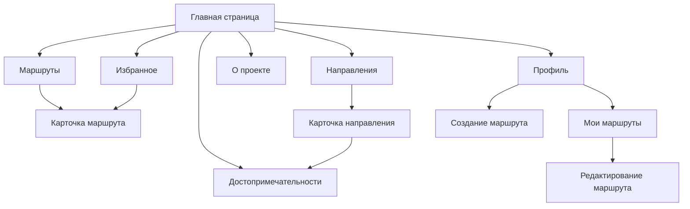

# Сайт для путешественников

## Назначение

Сайт помогает находить готовые маршруты и направления для путешествий, изучать достопримечательности, сохранять интересные варианты в избранное и создавать собственные маршруты.

Проект должен содержать не менее десяти страниц и предусматривать базу данных объектов маршрута. Для каждого объекта необходимо хранить минимум пять полей, чтобы в дальнейшем можно было реализовать поиск, фильтрацию и сортировку.

## Принципы интерфейса

- Адаптивная вёрстка для смартфонов и компьютеров.
- Единый состав шапки, навигации и основных блоков на всех страницах.
- Переход к любой значимой странице не более чем за 2–3 действия.
- Главная страница не должна смешивать новости, маршруты и справочные материалы в одну неструктурированную ленту.
- Каталог должен поддерживать фильтрацию маршрутов по региону, типу, длительности и сложности.

## Основные разделы

| Раздел | Назначение |
| --- | --- |
| Главная | Точка входа, навигация по ключевым разделам и подборки маршрутов. |
| Маршруты | Каталог маршрутов с поиском, фильтрами и переходом к карточке маршрута. |
| Карточка маршрута | Подробности маршрута: описание, точки, длительность, сложность и связанные достопримечательности. |
| Направления | Каталог регионов или направлений для путешествий. |
| Карточка направления | Описание направления и список его достопримечательностей. |
| Достопримечательности | Справочник интересных мест, связанных с направлениями и маршрутами. |
| Избранное | Сохранённые пользователем маршруты; из списка можно открыть карточку маршрута. |
| О проекте | Информация о сайте и его возможностях. |
| Профиль | Вход в личный кабинет пользователя. |
| Мои маршруты | Список маршрутов пользователя с возможностью редактирования. |
| Создание маршрута | Форма создания нового маршрута. |
| Редактирование маршрута | Изменение данных созданного пользователем маршрута. |

## Логическая структура

Исходная схема: [схема страниц](images/site-map.png).

## Прототипы ключевых страниц

### Главная страница

[Прототип главной страницы](images/home-page.png)

На странице должны быть:

- шапка с логотипом, основным меню и действиями пользователя;
- заметный блок поиска или подбора маршрута;
- ссылки на каталог маршрутов, направления, избранное и профиль;
- подборки популярных или рекомендуемых маршрутов;
- единый подвал с дополнительной навигацией и информацией о проекте.

### Каталог маршрутов

[Прототип каталога маршрутов](images/routes-catalog.png)

Каталог состоит из списка карточек маршрутов и панели фильтров. Фильтры должны позволять отбирать маршруты по региону, типу путешествия, длительности и сложности. Карточка в каталоге ведёт на отдельную страницу маршрута.

### Страница маршрута

[Прототип страницы маршрута](images/route-page.png)

Страница должна показывать название, обложку, описание, ключевые параметры маршрута и список точек. Пользователь может перейти к связанным достопримечательностям и добавить маршрут в избранное.

### Профиль пользователя

[Прототип карточки пользователя](images/user-profile.png)

Профиль является входом в личный кабинет. Из него доступны «Мои маршруты» и создание нового маршрута; в списке своих маршрутов пользователь может открыть форму редактирования.
